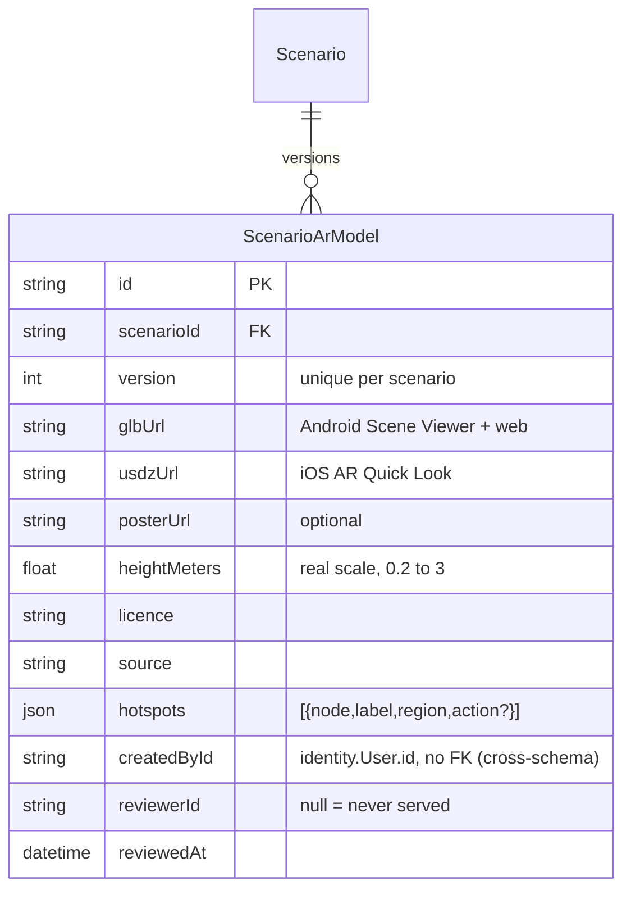

# Data: a scenario's 3D casualty (AR MVP, "look before you act")

Status: built 2026-11-08. Product context: `docs/product/ar-spike.md` (verdict, MIME gotcha, MVP table).

## Model



**Why a separate table, not JSON on `Scenario`:**
- **Versioning.** Replacing a model adds a row; nothing is edited in place. A reviewed v1 keeps serving while v2 waits for review, and the audit trail shows who signed off which file.
- **Review is per model, not per scenario.** A scenario is locked while published, but a model needs its own physician sign-off, and that has to work on a published scenario without unpublishing it. Columns (`reviewerId`, `reviewedAt`) are queryable and indexed by the unique key; a JSON blob isn't.
- **v2 (ViroReact) needs no rework.** `hotspots` already holds named nodes, a body region and an optional `action` (a `ScenarioAction.id`). v2 makes them tappable and sends the action into the existing scoring engine. Hotspots stay JSON because they're always read whole with the model and validated by zod (`src/lib/validators/ar-model.ts`). New regions are a code change, not a migration.

**Rules (enforced in `src/server/scenarios/ar-model.ts`, tested in `test/integration/ar-models.test.ts`):**
- Only physicians/admins attach, list or review.
- Two-person rule, like publishing: the physician who attached a version can't review it (admins excepted).
- Learners (web and the `GET /api/v1/scenarios/:id` brief) get only the newest version with `reviewedAt` set. Unreviewed versions are never served.
- A hotspot's `action` must be an action of the same scenario.
- URLs: a site path (`/models/...`) or `https://`, with the right extension. Site paths are returned absolute (from `APP_URL`) so the phone can hand them to Quick Look / Scene Viewer.

No PII or PHI. `createdById`/`reviewerId` are staff ids in the content schema, the same as `Scenario.authorId`/`reviewerId`.

## Hosting

Files are committed under `public/models/<scenario-slug>/v<n>/` (`patient.glb`, `patient.usdz`, `poster.webp`) and served by the Next.js app on Railway over HTTPS. Headers come from `src/lib/model-headers.ts`:

| Path | Header |
|---|---|
| any `*.usdz` | `Content-Type: model/vnd.usdz+zip` (Quick Look shows "Zero KB" without it) |
| any `*.glb` | `Content-Type: model/gltf-binary` |
| `/models/*` | `Cache-Control: public, max-age=31536000, immutable`, `Access-Control-Allow-Origin: *` |

Folders are versioned and never overwritten, so the one-year immutable cache is safe. A new version gets a new folder.

Why not the alternatives yet:
- **Railway volume:** a volume isn't served by Next's static handler (we'd need a streaming route), it ties the service to one instance, and it's backed up separately from git.
- **R2/S3:** the right home once models are large or numerous, or admins need to upload from the browser. It's a new service/account, so it waits for Farjad's OK. Moving is a data change only: upload the files, then attach a new version with the `https://` URLs.

Budget: ≤ 5 MB per file (spike target). At ~20 models × 2 formats, the repo grows by ~100–200 MB over time. Past ~10 real models, move to R2.

Admin "upload" is therefore by URL in the MVP: put the files in `public/models/...` in a PR (or on a CDN), then attach them in the editor's **3D model** tab.

## Migration

`prisma/migrations/20261108200000_scenario_ar_model/migration.sql`: additive only (one new table, one unique index, one FK with cascade from `Scenario`). It's safe for `prisma migrate deploy` on Railway: no lock on existing tables beyond the FK's brief `SHARE ROW EXCLUSIVE` on `content."Scenario"`.

Rollback (Farjad runs; only after reverting the app code that reads the table):

```sql
DROP TABLE "content"."ScenarioArModel";
DELETE FROM "_prisma_migrations" WHERE migration_name = '20261108200000_scenario_ar_model';
```

## API

`GET /api/v1/scenarios/:id` (learner brief): every existing field plus `arModel` (`null` or the shape below). App build 5 ignores unknown fields.

```json
"arModel": {
  "id": "cm…",
  "version": 2,
  "glbUrl": "https://www.imedica.tech/models/catastrophic-limb-hemorrhage/v2/patient.glb",
  "usdzUrl": "https://www.imedica.tech/models/catastrophic-limb-hemorrhage/v2/patient.usdz",
  "posterUrl": "https://www.imedica.tech/models/catastrophic-limb-hemorrhage/v2/poster.webp",
  "heightMeters": 1.75,
  "attribution": { "licence": "CC0-1.0", "source": "Quaternius, Ultimate Modular Men" },
  "hotspots": []
}
```

Authors: `GET /api/v1/scenarios/:id` also includes `arModels` (all versions, newest first). There are also `GET|POST /api/v1/scenarios/:id/ar-models` and `POST /api/v1/scenarios/:id/ar-models/:modelId/review` (`{ "action": "approve" | "revoke" }`).

## Seed

`prisma/seed.ts` attaches the AR spike's CC0 placeholder (`/ar-spike/models/…`) to `catastrophic-limb-hemorrhage` as an **unreviewed** v1, and only outside deployed environments.
